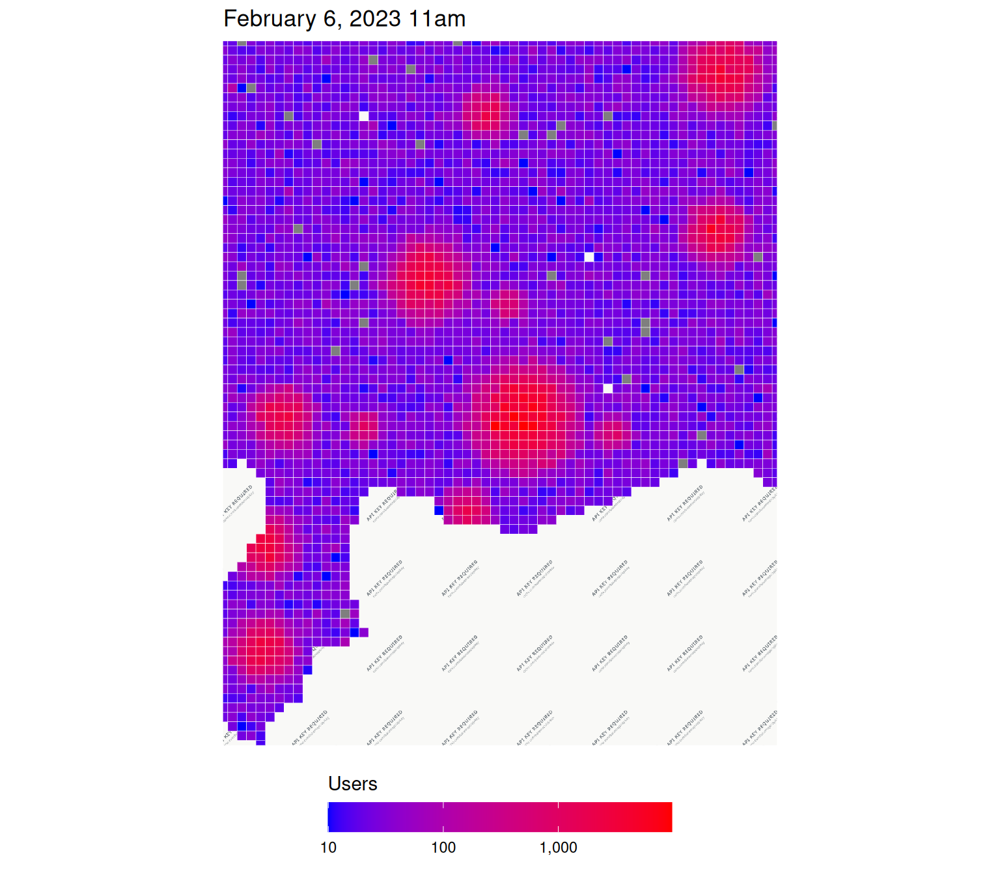
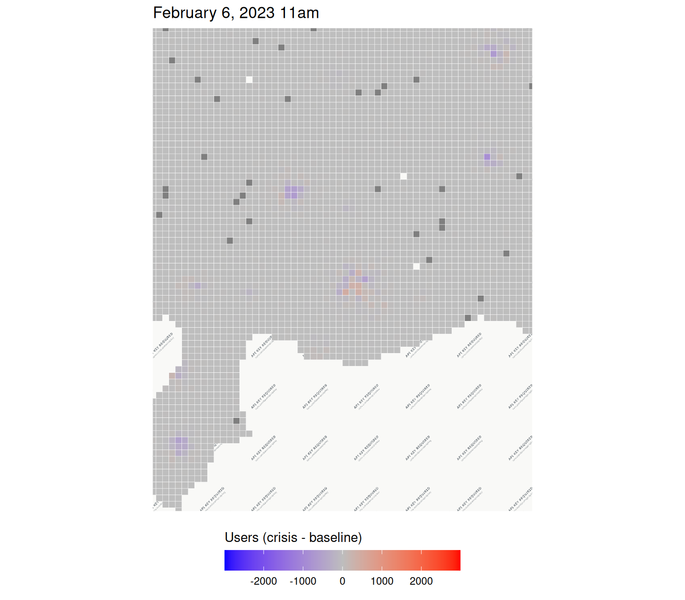
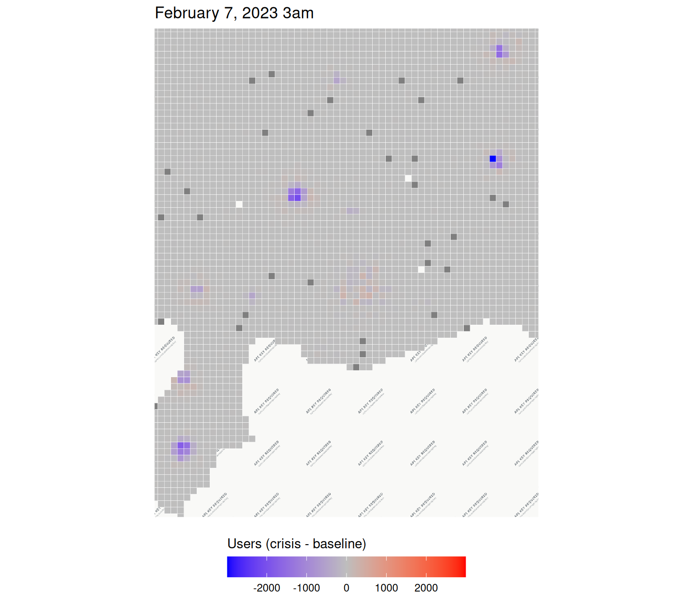
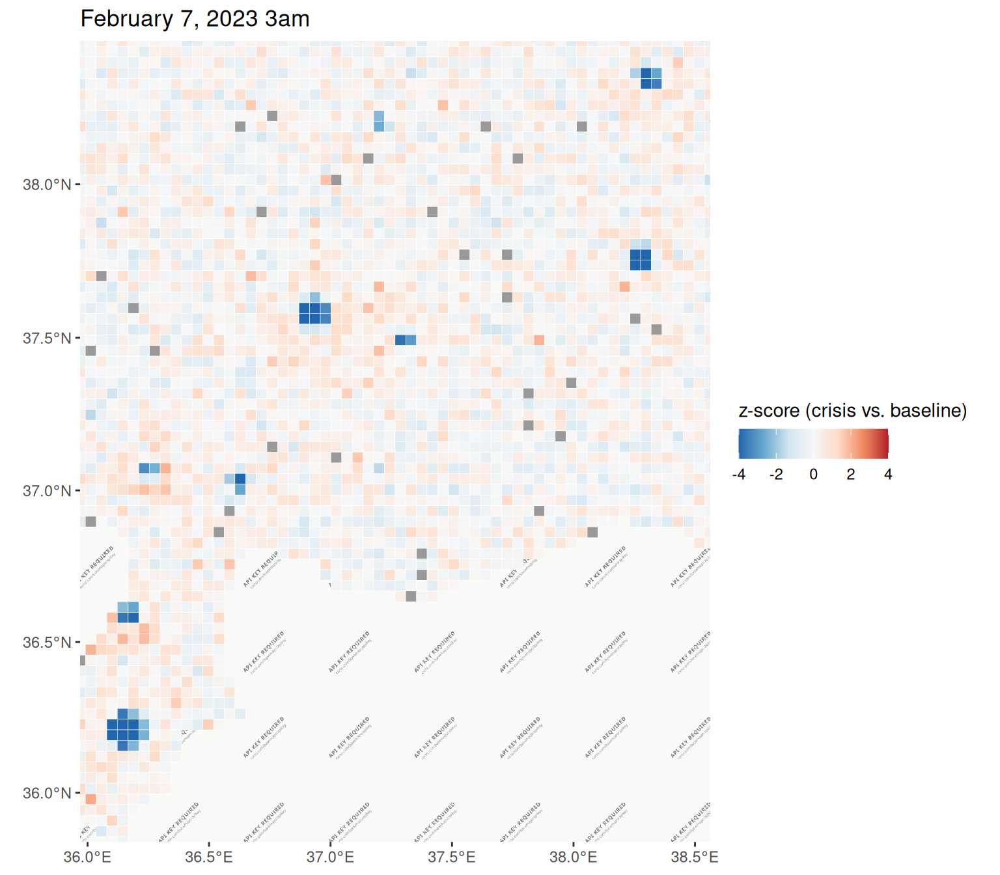
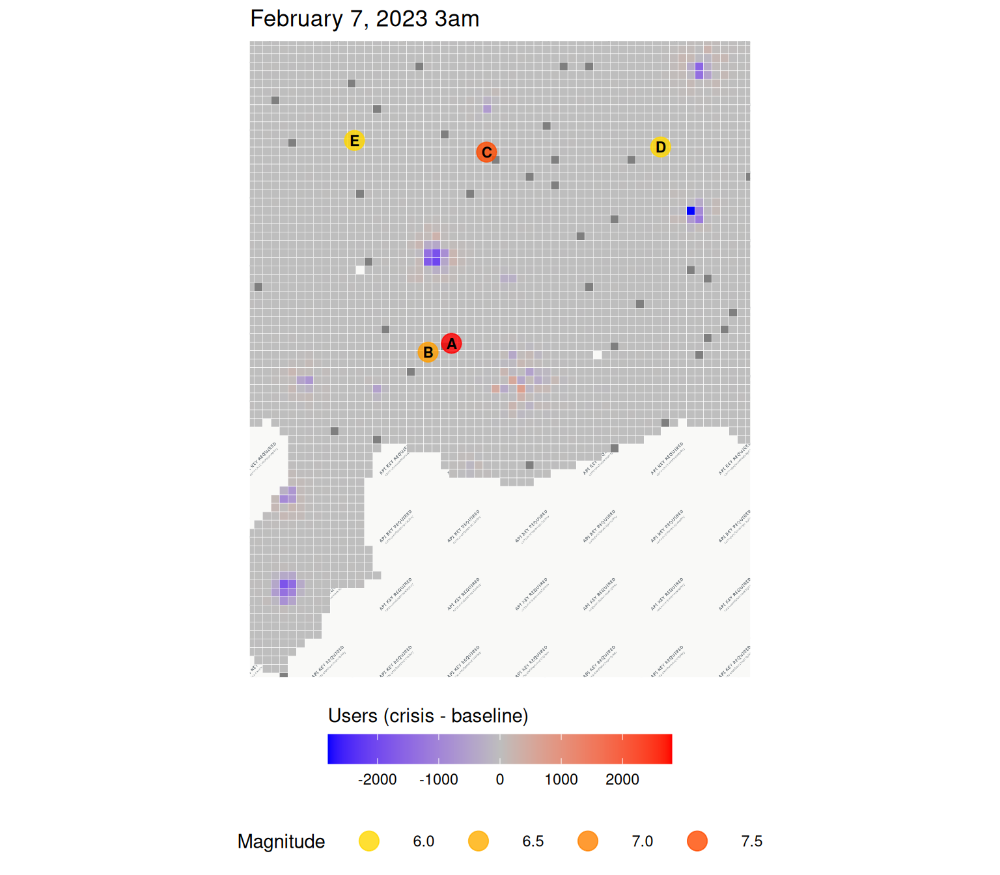
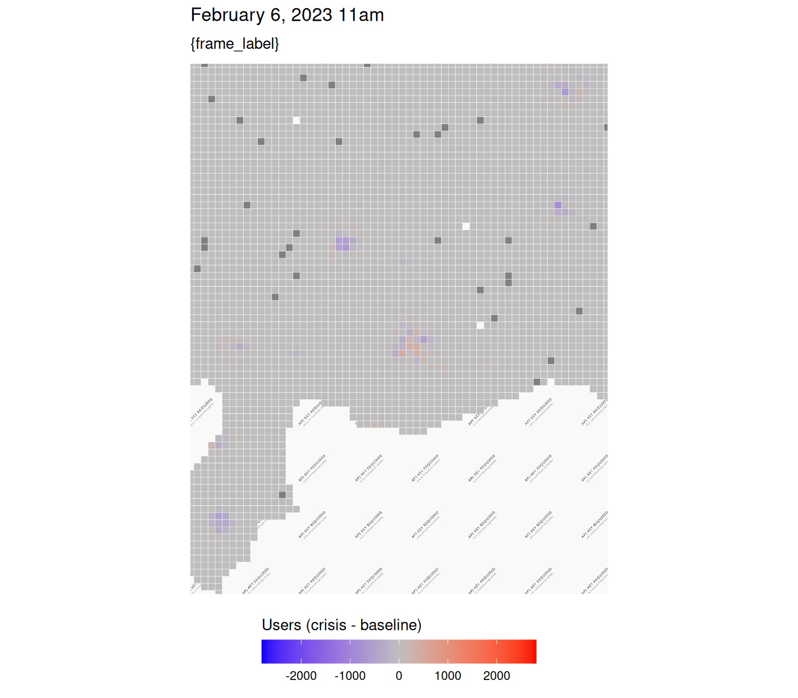

# Earthquakes

``` r

library(disasterMaps)

tzone <- "Europe/Istanbul"
```

## Data

``` r

data_dir <- system.file("extdata", "earthquake", "population", package = "disasterMaps")
list.files(data_dir)
#> [1] "turkey_earthquake_2023-02-06_0000.csv"
#> [2] "turkey_earthquake_2023-02-06_1600.csv"

fb_data_bing <- aggregate_csvs(data_dir)
head(fb_data_bing)
#> # A tibble: 6 × 15
#>   latitude longitude quadkey     country date_time           n_baseline n_crisis
#>      <dbl>     <dbl> <chr>       <chr>   <dttm>                   <dbl>    <dbl>
#> 1     38.5      36.0 1221102112… TR      2023-02-06 08:00:00         24       19
#> 2     38.5      36.0 1221102112… TR      2023-02-06 08:00:00         18       19
#> 3     38.5      36.1 1221102112… TR      2023-02-06 08:00:00         13       NA
#> 4     38.5      36.1 1221102112… TR      2023-02-06 08:00:00         23       32
#> 5     38.5      36.1 1221102112… TR      2023-02-06 08:00:00         20       20
#> 6     38.5      36.2 1221102112… TR      2023-02-06 08:00:00         37       36
#> # ℹ 8 more variables: n_difference <dbl>, density_baseline <dbl>,
#> #   density_crisis <dbl>, percent_change <dbl>, z_score <dbl>, ds <date>,
#> #   source_file <chr>, hour <chr>
```

``` r

analyze_dataset(fb_data_bing)
#> $missing
#> # A tibble: 1 × 15
#>   latitude longitude quadkey country date_time n_baseline n_crisis n_difference
#>      <dbl>     <dbl>   <dbl>   <dbl>     <dbl>      <dbl>    <dbl>        <dbl>
#> 1        0         0       0       0         0   0.000778   0.0104       0.0112
#> # ℹ 7 more variables: density_baseline <dbl>, density_crisis <dbl>,
#> #   percent_change <dbl>, z_score <dbl>, ds <dbl>, source_file <dbl>,
#> #   hour <dbl>
#> 
#> $numeric_summary
#> # A tibble: 1 × 18
#>   latitude_mean latitude_sd longitude_mean longitude_sd n_baseline_mean
#>           <dbl>       <dbl>          <dbl>        <dbl>           <dbl>
#> 1          37.5       0.598           37.2        0.771            174.
#> # ℹ 13 more variables: n_baseline_sd <dbl>, n_crisis_mean <dbl>,
#> #   n_crisis_sd <dbl>, n_difference_mean <dbl>, n_difference_sd <dbl>,
#> #   density_baseline_mean <dbl>, density_baseline_sd <dbl>,
#> #   density_crisis_mean <dbl>, density_crisis_sd <dbl>,
#> #   percent_change_mean <dbl>, percent_change_sd <dbl>, z_score_mean <dbl>,
#> #   z_score_sd <dbl>
#> 
#> $n_rows
#> [1] 6423
#> 
#> $n_cols
#> [1] 15
```

## Movement data

``` r

move_dir <- system.file("extdata", "earthquake", "movement", package = "disasterMaps")
list.files(move_dir)
#> [1] "turkey_earthquake_movement_2023-02-06_0000.csv"
#> [2] "turkey_earthquake_movement_2023-02-06_1600.csv"

mp_data_bing <- aggregate_csvs(move_dir)
head(mp_data_bing)
#> # A tibble: 6 × 17
#>   start_latitude start_longitude end_latitude end_longitude length_km
#>            <dbl>           <dbl>        <dbl>         <dbl>     <dbl>
#> 1           38.5            36.0         38.5          36.0         0
#> 2           38.5            36.0         38.5          36.0         0
#> 3           38.4            36.0         38.4          36.0         0
#> 4           38.4            36.0         38.4          36.0         0
#> 5           38.5            36.1         38.5          36.1         0
#> 6           38.5            36.1         38.5          36.1         0
#> # ℹ 12 more variables: start_quadkey <chr>, end_quadkey <chr>, country <chr>,
#> #   date_time <dttm>, n_baseline <dbl>, n_crisis <dbl>, n_difference <dbl>,
#> #   percent_change <dbl>, z_score <dbl>, ds <date>, source_file <chr>,
#> #   hour <chr>

moved <- build_moved(mp_data_bing, re_run = TRUE, cache_dir = tempdir())
```

## Tiles and time windows

``` r

tiles_3857 <- build_tiles(fb_data_bing, re_run = TRUE, cache_dir = tempdir())
#> Building tile polygons for 3213 distinct quadkeys (6423 rows total) -> /tmp/RtmphHM0se/tiles.Rds

w <- compute_windows(fb_data_bing, tzone)
w
#> $first_ds
#> [1] "2023-02-06"
#> 
#> $first_hour
#> [1] "0000"
#> 
#> $latest_ds
#> [1] "2023-02-06"
#> 
#> $latest_hour
#> [1] "1600"
#> 
#> $first_label
#> [1] "February 6, 2023 11am"
#> 
#> $latest_label
#> [1] "February 7, 2023 3am"

lon_limits <- range(fb_data_bing$longitude)
lat_limits <- range(fb_data_bing$latitude)
zoom <- fit_zoom(lon_limits, lat_limits, zoom = 10)

# One colour scale for both windows
diff_limits <- shared_limits(
  "Difference between baseline and crisis", symmetric = TRUE,
  ds1 = w$first_ds, hour1 = w$first_hour,
  ds2 = w$latest_ds, hour2 = w$latest_hour
)
```

## Population during the crisis

``` r
population_plot_n_crisis(
  plot_ds = w$first_ds, plot_hour = w$first_hour, tzone = tzone,
  lon_limits = lon_limits, lat_limits = lat_limits, zoom = zoom
)
#> 
|---------|---------|---------|---------|
=========================================
                                          
```



## Change from baseline

### First window

``` r

population_plot_n_difference(
  plot_ds = w$first_ds, plot_hour = "0000", tzone = tzone,
  lon_limits = lon_limits, lat_limits = lat_limits, zoom = zoom,
  fill_limits = diff_limits
)
```



### Second window

``` r

population_plot_n_difference(
  plot_ds = w$first_ds, plot_hour = "1600", tzone = tzone,
  lon_limits = lon_limits, lat_limits = lat_limits, zoom = zoom,
  fill_limits = diff_limits
)
```



## Z-scores

``` r

population_plot(
  plot_ds = w$latest_ds, plot_hour = w$latest_hour, tzone = tzone,
  metric = "zscore",
  lon_limits = lon_limits, lat_limits = lat_limits, zoom = zoom
)
```



## Earthquake epicentres

``` r

start_date <- as.Date(w$first_ds) - 1
end_date <- as.Date(w$latest_ds) + 1
min_magnitude <- 6

population_plot_n_difference(
  plot_ds = w$latest_ds, plot_hour = w$latest_hour, tzone = tzone,
  lon_limits = lon_limits, lat_limits = lat_limits, zoom = zoom,
  fill_limits = diff_limits,
  disaster_type = "earthquake",
  start_date = start_date,
  end_date = end_date,
  min_magnitude = min_magnitude
)
#> Coordinate system already present.
#> ℹ Adding new coordinate system, which will replace the existing one.
```



## Animation

``` r

animation <- population_plot_animate(
  metric = "difference", tzone = tzone,
  lon_limits = lon_limits, lat_limits = lat_limits, zoom = zoom,
  fill_limits = diff_limits, fps = 1
)
#> `nframes` and `fps` adjusted to match transition
animation
```


