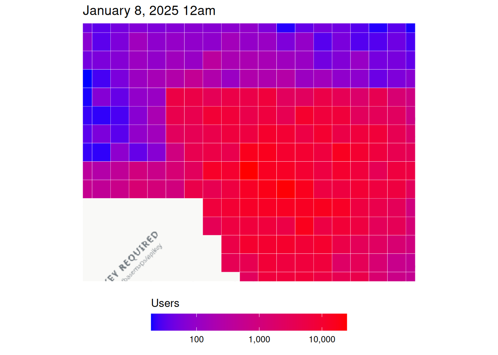
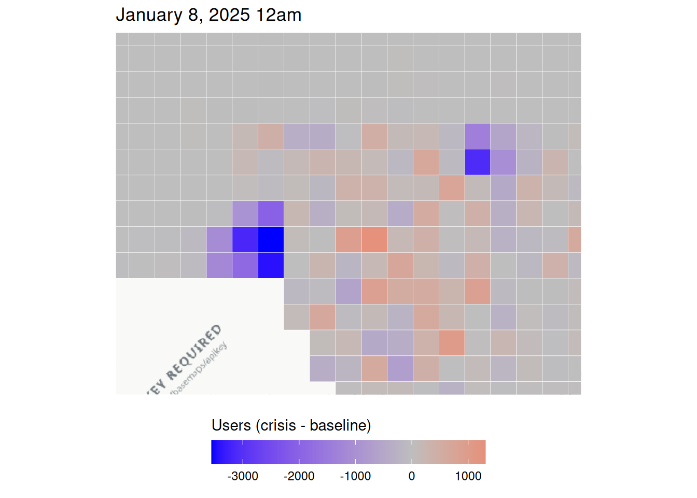
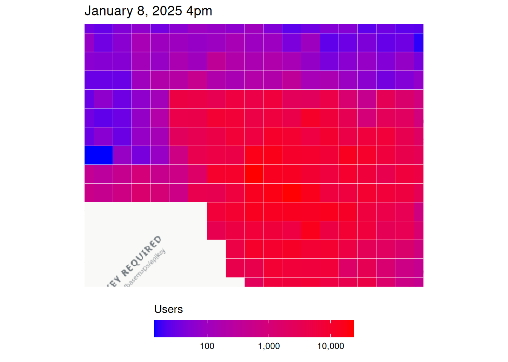
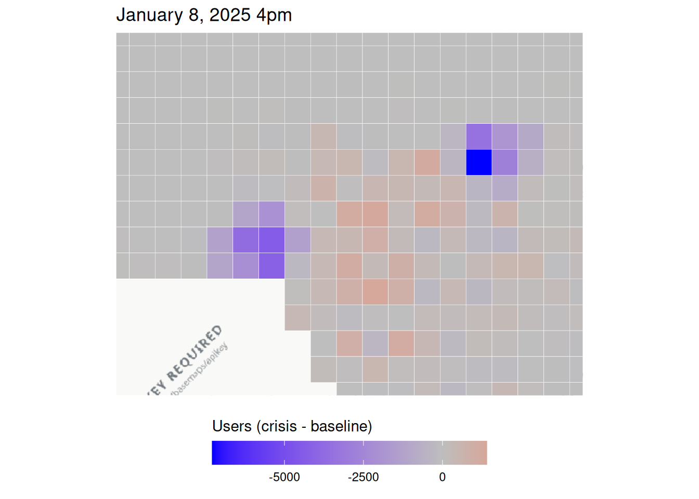
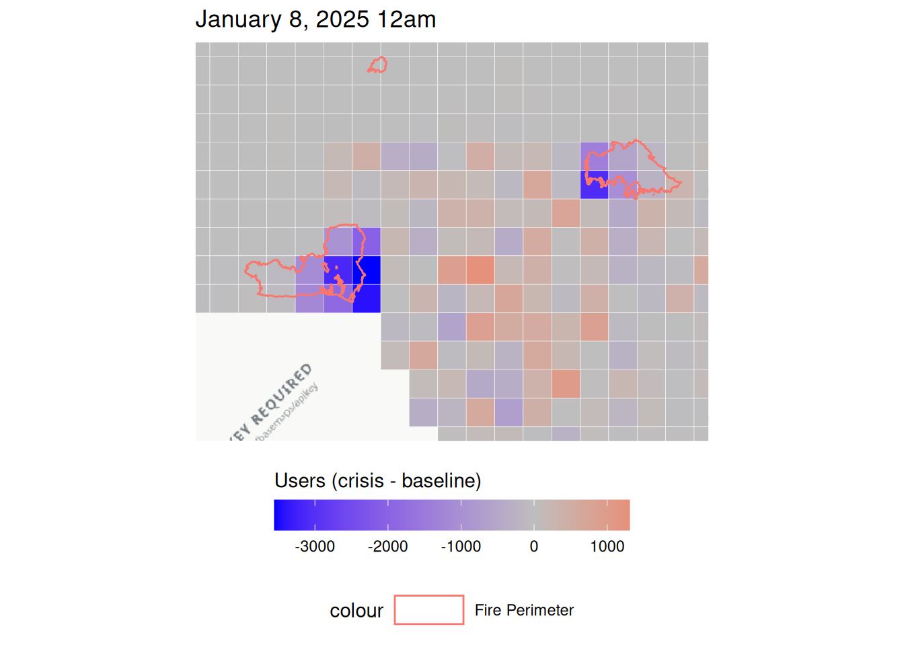
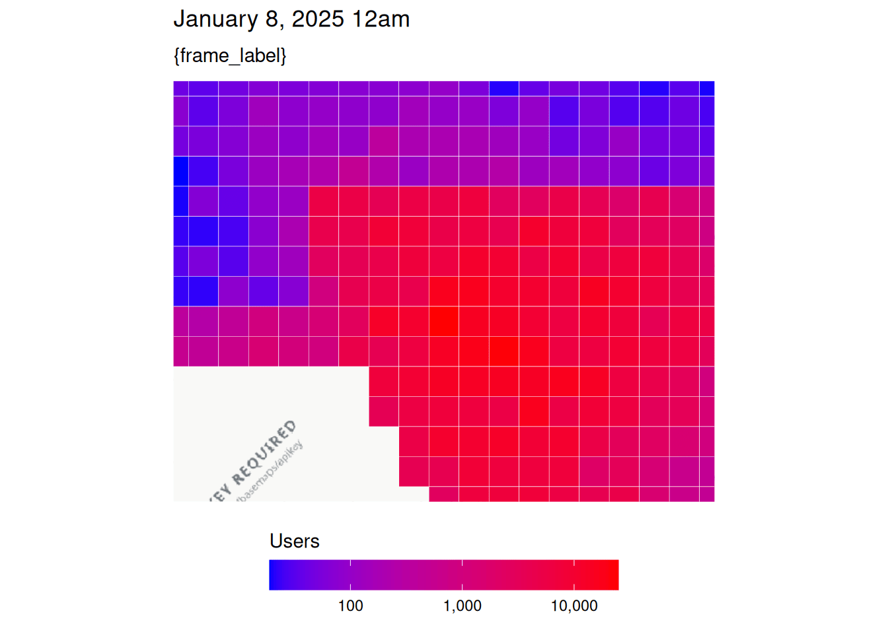
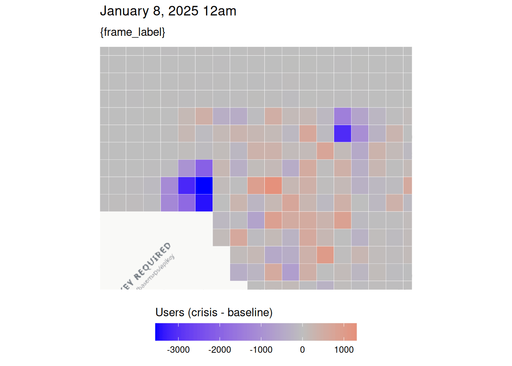

# Exploratory Data Analysis (Disaster-Agnostic)

## Instructions

Make sure you set `tzone` in the code chunk below to the relevant
timezone. Then, you can run this file to get rough population and
displacement plots for the first and last timepoints.

## Data Cleaning + Loading

``` r

library(disasterMaps)

disaster <- "fire" # "fire" or "earthquake" (synthetic data shipped with the package)
tzone <- c(fire = "America/Los_Angeles",
           earthquake = "Europe/Istanbul")[[disaster]] # ENTER TIMEZONE HERE

pop_dir  <- system.file("extdata", disaster, "population", package = "disasterMaps")
move_dir <- system.file("extdata", disaster, "movement", package = "disasterMaps")

fb_data_bing <- aggregate_csvs(pop_dir)
tiles_3857   <- build_tiles(fb_data_bing, re_run = TRUE, cache_dir = tempdir())
w <- compute_windows(fb_data_bing, tzone)
attach(w)
mp_data_bing <- aggregate_csvs(move_dir)
moved <- build_moved(mp_data_bing, re_run = TRUE, cache_dir = tempdir())

lon_limits <- range(fb_data_bing$longitude)
lat_limits <- range(fb_data_bing$latitude)
zoom <- fit_zoom(lon_limits, lat_limits, zoom = 10)

# OpenStreetMap roads drawn on top: "none", "major", "secondary" or "all"
highway_detail <- "major"
```

## First Timestamp

### Population Map

``` r

population_plot_n_crisis(plot_ds = w[["first_ds"]],
                             plot_hour = w[["first_hour"]],
                             lon_limits = lon_limits,
                             lat_limits = lat_limits,
                             zoom = zoom,
                             tzone = tzone,
                             highway_detail = highway_detail
                             )
```

    Waiting 14.999694108963 seconds

    Warning in value[[3L]](cond): Could not download highway data from
    OpenStreetMap: HTTP 502 Bad Gateway.



### Displacement Map

``` r

population_plot_n_difference(plot_ds = w[["first_ds"]],
                             plot_hour = w[["first_hour"]],
                             lon_limits = lon_limits,
                             lat_limits = lat_limits,
                             zoom = zoom,
                             tzone = tzone,
                             highway_detail = highway_detail
                             )
```

    Waiting 14.9997725486755 seconds

    Warning in value[[3L]](cond): Could not download highway data from
    OpenStreetMap: HTTP 502 Bad Gateway.



## Last Timestamp

### Population Map

``` r

population_plot_n_crisis(plot_ds = w[["latest_ds"]],
                             plot_hour = w[["latest_hour"]],
                             lon_limits = lon_limits,
                             lat_limits = lat_limits,
                             zoom = zoom,
                             tzone = tzone,
                             highway_detail = highway_detail
                             )
```

    Waiting 14.999785900116 seconds

    Warning in value[[3L]](cond): Could not download highway data from
    OpenStreetMap: HTTP 502 Bad Gateway.



### Displacement

``` r

population_plot_n_difference(plot_ds = w[["latest_ds"]],
                             plot_hour = w[["latest_hour"]],
                             lon_limits = lon_limits,
                             lat_limits = lat_limits,
                             zoom = zoom,
                             tzone = tzone,
                             highway_detail = highway_detail
)
```

    Waiting 14.9997680187225 seconds

    Warning in value[[3L]](cond): Could not download highway data from
    OpenStreetMap: HTTP 502 Bad Gateway.



## Disaster-Specific

### Earthquakes

``` r

# start and end dates for earthquakes, which can be adjusted
start_date <- as.Date(w[["first_ds"]]) - 1
end_date <- as.Date(w[["latest_ds"]]) + 1
min_magnitude <- 6

# if you want shared legends, use disaster_limits()!!

population_plot_n_difference(plot_ds = w[["first_ds"]],
                             plot_hour = w[["first_hour"]],
                             lon_limits = lon_limits,
                             lat_limits = lat_limits,
                             zoom = zoom,
                             tzone = tzone,
                             highway_detail = highway_detail,
                             disaster_type = "earthquake",
                             start_date = start_date,
                             end_date = end_date,
                             min_magnitude = min_magnitude
                             )
```

### Fires

``` r

# start and end dates for fires, which can be adjusted
start_date <- as.Date(w[["first_ds"]]) - 7
end_date <- as.Date(w[["latest_ds"]]) + 1

population_plot_n_difference(plot_ds = w[["first_ds"]],
                             plot_hour = w[["first_hour"]],
                             lon_limits = lon_limits,
                             lat_limits = lat_limits,
                             zoom = zoom,
                             tzone = tzone,
                             highway_detail = highway_detail,
                             disaster_type = "fire",
                             start_date = start_date,
                             end_date = end_date
                             )
```

    Waiting 14.99977850914 seconds

    Warning in value[[3L]](cond): Could not download highway data from
    OpenStreetMap: HTTP 502 Bad Gateway.

    Downloading wildfire perimeters from WFIGS...

    Dates: 2025-01-01 to 2025-01-09

    Longitude: -118.762207 to -117.971191

    Latitude: 33.85217 to 34.361576

    Downloaded 4 fire perimeter(s).



## Animations

### Population Animation

``` r

crisis_animation <- population_plot_animate(
  metric = "crisis",
  tzone = tzone,
  lon_limits = lon_limits,
  lat_limits = lat_limits,
  zoom = zoom,
  fps = 1
)
```

    `nframes` and `fps` adjusted to match transition

``` r

crisis_animation
```



### Population Animation

``` r

difference_animation <- population_plot_animate(
  metric = "difference",
  tzone = tzone,
  lon_limits = lon_limits,
  lat_limits = lat_limits,
  zoom = zoom,
  fps = 1
)
```

    `nframes` and `fps` adjusted to match transition

``` r

difference_animation
```


