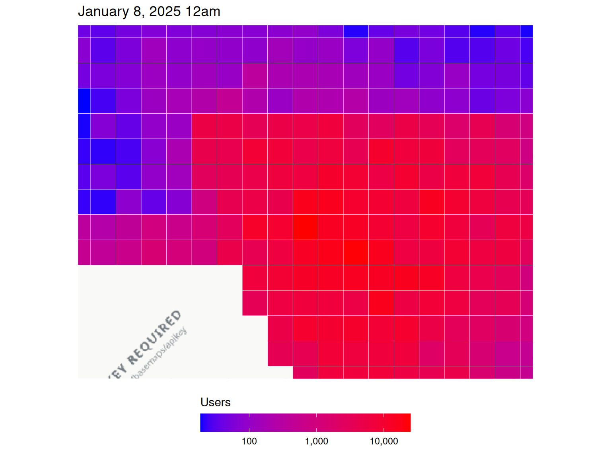
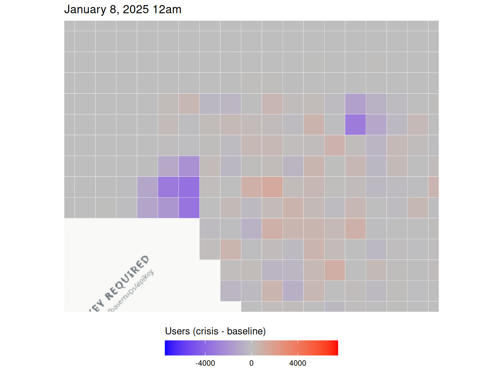
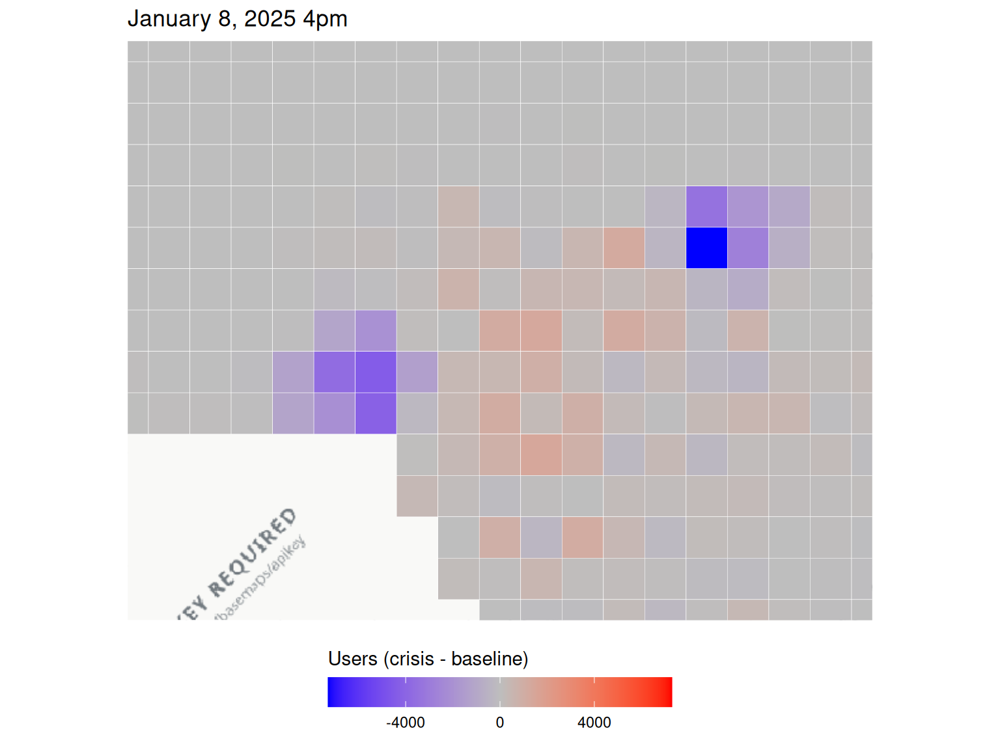
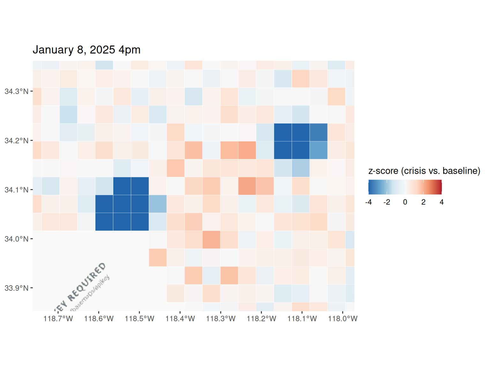
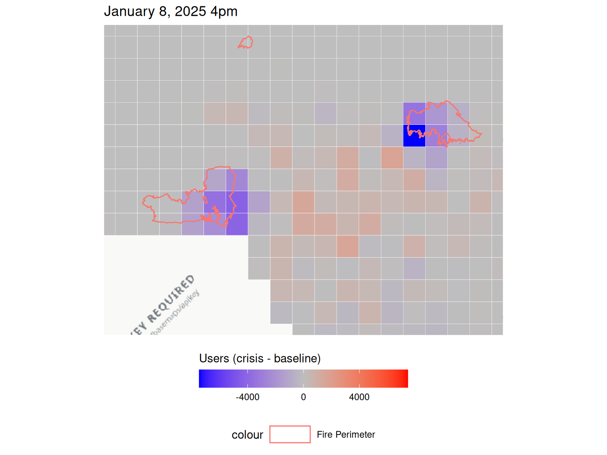
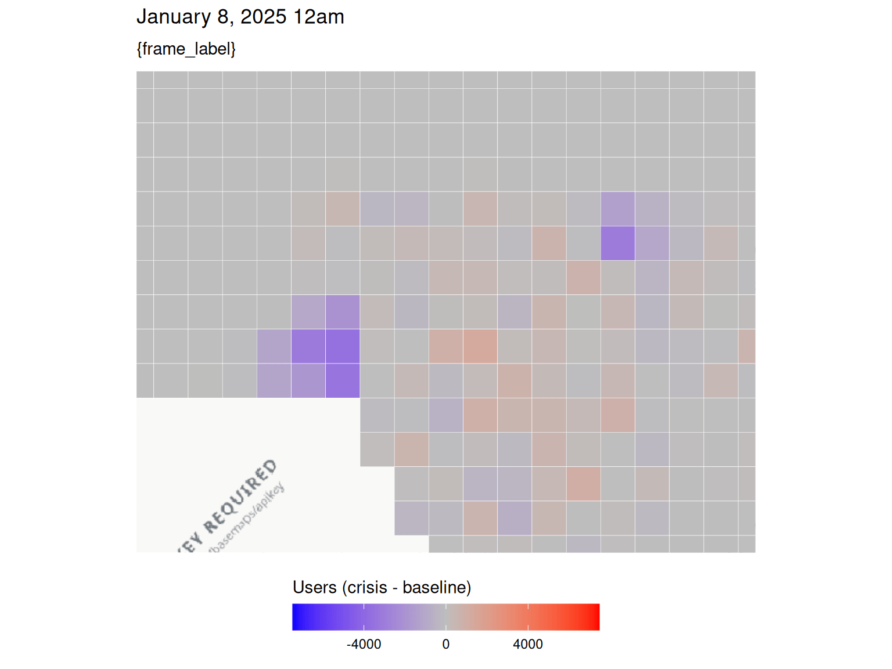

# Wildfires

``` r

library(disasterMaps)

tzone <- "America/Los_Angeles"
```

## Data

``` r

data_dir <- system.file("extdata", "fire", "population", package = "disasterMaps")
list.files(data_dir)
#> [1] "la_wildfire_2025-01-08_0000.csv" "la_wildfire_2025-01-08_1600.csv"

tiles_3857 <- load_population(data_dir, re_run = TRUE, cache_dir = tempdir())
head(tiles_3857)
#> Simple feature collection with 6 features and 15 fields
#> Geometry type: POLYGON
#> Dimension:     XY
#> Bounding box:  xmin: -13222990 ymin: 4075011 xmax: -13208320 ymax: 4079903
#> Projected CRS: WGS 84 / Pseudo-Mercator
#>         quadkey latitude longitude country           date_time n_baseline
#> 1 0230121332221 34.36158 -118.7622      US 2025-01-08 08:00:00         40
#> 2 0230121332221 34.36158 -118.7622      US 2025-01-09 00:00:00         39
#> 3 0230121332230 34.36158 -118.7183      US 2025-01-08 08:00:00         34
#> 4 0230121332230 34.36158 -118.7183      US 2025-01-09 00:00:00         33
#> 5 0230121332231 34.36158 -118.6743      US 2025-01-08 08:00:00         47
#> 6 0230121332231 34.36158 -118.6743      US 2025-01-09 00:00:00         45
#>   # Users During Crisis Difference between baseline and crisis density_baseline
#> 1                    43                                      3      4.16283e-05
#> 2                    35                                     -4      4.18429e-05
#> 3                    34                                      0      3.53840e-05
#> 4                    28                                     -5      3.54056e-05
#> 5                    48                                      1      4.89132e-05
#> 6                    47                                      2      4.82803e-05
#>   density_crisis percent_change z_score         ds
#> 1    4.52424e-05         7.5000  0.2306 2025-01-08
#> 2    3.81661e-05       -10.2564 -0.3127 2025-01-08
#> 3    3.57731e-05         0.0000  0.0000 2025-01-08
#> 4    3.05329e-05       -15.1515 -0.4318 2025-01-08
#> 5    5.05031e-05         2.1277  0.0706 2025-01-08
#> 6    5.12516e-05         4.4444  0.1436 2025-01-08
#>                       source_file hour                       geometry
#> 1 la_wildfire_2025-01-08_0000.csv 0000 POLYGON ((-13222994 4075011...
#> 2 la_wildfire_2025-01-08_1600.csv 1600 POLYGON ((-13222994 4075011...
#> 3 la_wildfire_2025-01-08_0000.csv 0000 POLYGON ((-13218102 4075011...
#> 4 la_wildfire_2025-01-08_1600.csv 1600 POLYGON ((-13218102 4075011...
#> 5 la_wildfire_2025-01-08_0000.csv 0000 POLYGON ((-13213210 4075011...
#> 6 la_wildfire_2025-01-08_1600.csv 1600 POLYGON ((-13213210 4075011...
```

``` r

analyze_dataset(tiles_3857)
#> $missing
#>   quadkey latitude longitude country date_time n_baseline # Users During Crisis
#> 1       0        0         0       0         0          0                     0
#>   Difference between baseline and crisis density_baseline density_crisis
#> 1                                      0                0              0
#>   percent_change z_score ds source_file hour
#> 1              0       0  0           0    0
#> 
#> $numeric_summary
#>   latitude_mean latitude_sd longitude_mean longitude_sd n_baseline_mean
#> 1       34.1367   0.1478261      -118.3279    0.2337444        3847.443
#>   n_baseline_sd # Users During Crisis_mean # Users During Crisis_sd
#> 1      4572.891                   3795.691                 4687.304
#>   Difference between baseline and crisis_mean
#> 1                                   -51.75203
#>   Difference between baseline and crisis_sd density_baseline_mean
#> 1                                  696.1121           0.004065041
#>   density_baseline_sd density_crisis_mean density_crisis_sd percent_change_mean
#> 1         0.004830559          0.00406504       0.005020139           -1.739888
#>   percent_change_sd z_score_mean z_score_sd
#> 1          16.66809   -0.2606837   1.988512
#> 
#> $n_rows
#> [1] 492
#> 
#> $n_cols
#> [1] 15
```

## Movement data

``` r

move_dir <- system.file("extdata", "fire", "movement", package = "disasterMaps")
list.files(move_dir)
#> [1] "la_wildfire_movement_2025-01-08_0000.csv"
#> [2] "la_wildfire_movement_2025-01-08_1600.csv"

moved <- load_movement(move_dir, re_run = TRUE, cache_dir = tempdir())
head(moved)
#> # A tibble: 6 × 17
#>   start_latitude start_longitude end_latitude end_longitude length_km
#>            <dbl>           <dbl>        <dbl>         <dbl>     <dbl>
#> 1           34.2           -119.         34.2         -118.      4.04
#> 2           34.2           -119.         34.2         -119.      4.04
#> 3           34.2           -119.         34.2         -118.      5.72
#> 4           34.2           -119.         34.1         -119.      8.09
#> 5           34.2           -119.         34.1         -118.      9.04
#> 6           34.2           -119.         34.1         -118.     12.8 
#> # ℹ 12 more variables: start_quadkey <chr>, end_quadkey <chr>, country <chr>,
#> #   date_time <dttm>, n_baseline <dbl>, `# Users During Crisis` <dbl>,
#> #   `Difference between baseline and crisis` <dbl>, percent_change <dbl>,
#> #   z_score <dbl>, ds <date>, source_file <chr>, hour <chr>
```

## Time windows and map extent

``` r

w <- compute_windows(tiles_3857, tzone)
w
#> $first_ds
#> [1] "2025-01-08"
#> 
#> $first_hour
#> [1] "0000"
#> 
#> $latest_ds
#> [1] "2025-01-08"
#> 
#> $latest_hour
#> [1] "1600"
#> 
#> $first_label
#> [1] "January 8, 2025 12am"
#> 
#> $latest_label
#> [1] "January 8, 2025 4pm"

lon_limits <- range(tiles_3857$longitude)
lat_limits <- range(tiles_3857$latitude)
zoom <- 10 # lowered automatically if the extent is too wide

# One colour scale for both windows
diff_limits <- shared_limits(
  "Difference between baseline and crisis", symmetric = TRUE,
  ds1 = w$first_ds, hour1 = w$first_hour,
  ds2 = w$latest_ds, hour2 = w$latest_hour
)
```

## Population during the crisis

``` r

population_plot_n_crisis(
  plot_ds = w$first_ds, plot_hour = w$first_hour, tzone = tzone,
  lon_limits = lon_limits, lat_limits = lat_limits, zoom = zoom
)
```



## Change from baseline

### 12am

``` r

population_plot_n_difference(
  plot_ds = w$first_ds, plot_hour = "0000", tzone = tzone,
  lon_limits = lon_limits, lat_limits = lat_limits, zoom = zoom,
  fill_limits = diff_limits
)
```



### 4pm

``` r

population_plot_n_difference(
  plot_ds = w$first_ds, plot_hour = "1600", tzone = tzone,
  lon_limits = lon_limits, lat_limits = lat_limits, zoom = zoom,
  fill_limits = diff_limits
)
```



## Z-scores

``` r

population_plot(
  plot_ds = w$latest_ds, plot_hour = w$latest_hour, tzone = tzone,
  metric = "zscore",
  lon_limits = lon_limits, lat_limits = lat_limits, zoom = zoom
)
```



## Fire perimeters

``` r

population_plot_n_difference(
  plot_ds = w$latest_ds, plot_hour = w$latest_hour, tzone = tzone,
  lon_limits = lon_limits, lat_limits = lat_limits, zoom = zoom,
  fill_limits = diff_limits,
  disaster_type = "fire",
  start_date = as.Date(w$first_ds) - 1,
  end_date = as.Date(w$latest_ds) + 1
)
#> Downloading wildfire perimeters from WFIGS...
#> Dates: 2025-01-07 to 2025-01-09
#> Longitude: -118.762207 to -117.971191
#> Latitude: 33.85217 to 34.361576
#> Downloaded 3 fire perimeter(s).
```



## Animation

``` r

animation <- population_plot_animate(
  metric = "difference", tzone = tzone,
  lon_limits = lon_limits, lat_limits = lat_limits, zoom = zoom,
  fill_limits = diff_limits, fps = 1
)
#> `nframes` and `fps` adjusted to match transition
animation
```


